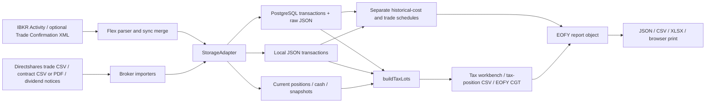

# SouthernStar tax integrity and FX evidence audit

**Date:** 15 October 2026, Australia/Sydney  
**Basis:** working tree at `2b7184f`, including the pre-existing uncommitted changes  
**Instruction:** [SouthernStar_Tax_Evidence_Export_Brief.md](/Users/sox/Desktop/SouthernStar/SouthernStar_Tax_Evidence_Export_Brief.md)  
**Status:** Repository and local-snapshot assessment delivered. Production and original-statement verification remain **not verified**. Implementation has not begun.

## Executive assessment

SouthernStar has substantial tax functionality worth preserving: a parcel engine, four parcel-selection methods with holding overrides, financial-year and range filters, pension treatment, corporate-action handling, duplicate detection, income schedules, reconciliation warnings, and a personal EOFY JSON/CSV/XLSX pack. The October 13 tax-engine brief predates several October 14 fixes. Its assertions were not used as findings without checking the current code.

The existing test command passes **399/399 tests**. A focused subset covering tax, imports, accounting and local transaction maintenance passes **114/114**. Additional isolated probes nevertheless reproduce material gaps: historical schedules disagree with the parcel engine; foreign-currency amounts use incompatible units; missing FX is treated as 1; a 365-day disposal gets the discount too early in an ATO example; and a personal profile can incorrectly enable pension treatment. The evidence-export requirements also expose an FX-read gap and absent cash-transaction ingestion and source-file retention.

There is no basis to declare production tax accuracy or Sharesight parity verified. No production database connection or broker credentials were available in the shell or relevant local environment configuration. No original IBKR, Westpac, Macquarie, Sharesight or artwork statements were available in the repository evidence locations inspected. A legacy local store was available and read without modification; its completeness and relationship to deployed data are unknown.

**Decision requested:** review the [discrepancy register](DISCREPANCY_REGISTER.md) and approve a specific remediation scope before any application, schema, import-data or deployment changes. The proposed sequence below preserves the existing engine and portfolio behavior.

## Audit boundaries and evidence

- **User-confirmed treatment, 15 October 2026:** the SMSF account is in **100% pension phase**. Use this as the current SMSF business rule when assessing the application's treatment. Partial-pension modeling is not required for its confirmed current state. This confirmation does not establish the value stored in production or an effective date for earlier tax years. F01 concerns the ability to apply pension treatment to Personal records.
- Application code, existing user edits, production data and the local portfolio store were not changed. No migrations, syncs, deployments, production imports or tax-profile mutations were executed. Synthetic import/profile checks wrote only disposable files under `/private/tmp/southernstar-tax-audit-20261015/`.
- The audit added only these documentation artifacts. No commit or stash was made: preserving the existing working tree takes precedence over the older brief's hygiene suggestion during a read-only audit.
- Actual local input: 123 personal Directshares trade records from 11 July 2024 through 16 June 2026, comprising 64 buys and 59 sells in AUD/CAD/USD; 26 stored positions across books; two AUD cash accounts; five import summaries. There are **no persisted IBKR transactions** or dividend records in this snapshot. All 123 trade rows lack settlement dates and net cash; all retain raw rows and an FX field. Missing fields here describe this snapshot, not every importer.
- Store SHA-256: `77417095dfbfa895d27be79f9fb9cfb06ddb6a8a833551da8cafd2c234cd3f03`, identical before and after report generation. Version 6 is normalized to version 7 in memory by the existing reader.
- Independent arithmetic was checked for **one fully matched AUD parcel** against its persisted source rows, not an original statement. It agrees to floating-point precision. Synthetic probes cover the additional cases listed in [EVIDENCE.md](EVIDENCE.md). No real bank/IBKR cash reconciliation was possible.
- Standard TypeScript checking fails on duplicate generated declarations named `* 2.ts` in `.next/types`. A diagnostic-only check excluding those three generated duplicate files has zero diagnostics. Nothing was deleted or regenerated. A production build and deployment were not attempted.

## Coverage matrix

“Verified” applies only to the explicit check described, never to an entire production module. “Failing” means a reproduced requirement or arithmetic discrepancy; absent features are labeled as coverage gaps.

| Area | Status | What was checked; remaining limit |
|---|---|---|
| Architecture and report inventory | Verified | Repository pages, APIs, sync paths, schema and serializers mapped below; deployed schema unverified. |
| Import completeness | Partially verified | Supported Flex sections inspected; synthetic cash rows are omitted. No source-to-import population reconciliation. |
| Exact reimport idempotency | Partially verified | One synthetic local IBKR row reimported: 0 new rows, 1 duplicate. PostgreSQL unique constraint inspected, not exercised. |
| Overlap/fill deduplication | Partially verified / Failing | Existing fixtures pass; P16 shows deduplicated CGT and duplicated trade/historical schedules. No real overlapping Flex files. |
| Corrections/cancellations | Failing / Not verified | Changed same-ID synthetic row ignored as duplicate; no correction history found. Broker cancellation variants not independently tested. |
| Holdings and cost bases | Partially verified / Failing | Existing partial-disposal/consolidation fixtures pass. LIFO historical schedule mismatch reproduced. DRP, transfer and return-of-capital accounting not source-verified. |
| Realised CGT | Partially verified / Failing | One persisted AUD parcel independently agrees; FIFO/other selection fixtures pass; fee, FX and discount-boundary failures reproduced. |
| Capital losses and summaries | Partially verified | Current-year losses offset short-term before discounted gains in fixture tests. No brought-forward general/collectable loss register or independently confirmed opening balances. |
| Income | Partially verified / Failing | Directshares notice/CSV fixtures pass; foreign raw gross conversion fails. Real income population, AMMA statements and franking evidence unavailable. |
| FX evidence | Failing / coverage gap | CASH trades parsed, but PostgreSQL reader excludes instrument-less rows. No complete two-leg evidence export or Division 775 engine; latter deliberately outside v1. |
| Cash reconciliation | Not verified | Current snapshots exist; no cash activity ledger imported from statements. Synthetic second-account cash deactivation reproduced. |
| Owner segregation | Partially verified / Failing | User confirms SMSF is 100% pension phase. Owner columns, foreign keys and filters exist; personal pension override permitted. Deployed profile values and actual account-to-owner mappings unverified. |
| Time boundaries | Partially verified / Failing | FY2026 bounds and ordinary range filters tested. Invalid calendar day accepted; original timestamp/timezone lineage and late adjustments unverified. |
| Report/export arithmetic | Partially verified / Failing | Serializers share an EOFY report object; local CSV contains its rounded net gain and repeats with identical inputs. Several reconciliation rows fail. No PDF visual or full XLSX-cell reconciliation performed. |
| Access controls | Partially verified | Production fail-closed auth, sessions, sync-key exception and existing policy tests inspected. No deployed penetration/authorization test. |
| Operational controls | Partially verified | Migrations, transactional PostgreSQL imports, sync statuses and recovery runbook exist. Deployed migrations, backups, restore drill, alert delivery and load behavior unverified. |
| Original statement comparisons | Not verified | No statement set or accountant-accepted output available to compare under identical settings. |

## Architecture and inventory

| Surface/path | Existing purpose and limits |
|---|---|
| `app/tax/page.tsx`, `/api/tax-lots` | Overall/personal/SMSF workbench; year selector, parcel election; realised period filters; open positions remain current. Overall deliberately applies accumulation treatment and does not preserve per-owner elections. It is an analytical view, unsuitable for the new single-owner evidence export. |
| `/reports/eofy`, `/api/reports/eofy` | AU personal accountant pack; `year=2026` means 1 July 2025–30 June 2026; JSON default, CSV/XLSX downloads and browser Print/Save PDF. Explicitly rejects SMSF; this is a documented design boundary, not the old brief's silent scope-discard bug. |
| `/reports/tax`, `/api/reports/tax-position` | Current tax/holding reference and parcel CSV; API accepts year or from/to. API can combine both owners; the new evidence report must require exactly one. Realised CSV totals are explicitly not an ATO net-capital-gain calculation. |
| `/reports`, wealth/estate APIs and pages | Report catalogue, holdings/cash/wealth/estate outputs. No standalone server PDF generator identified. |
| `/imports`, `/api/import/ibkr`, Directshares/dividend import routes | Preview and commit imports. IBKR preview parses the supplied body without persistence; commit assigns the selected owner. Source files are not archived. |
| `/sync`, `/api/sync`, `/api/sync/ibkr`, `lib/sync/full-sync.ts` | Activity Flex plus optional trade confirmations; Directshares confirmation/dividend mailbox imports; quote refresh and snapshots. |
| `scripts/start-railway.mjs`, `workers/daily-sync.ts` | Startup/daily sync and intraday price refresh. These are mutating operations and were not invoked. |
| `/cash`, `/api/cash` | Manually maintained external cash balances, including Macquarie labels. No Westpac/Macquarie transaction-statement parser found. |
| `lib/integrations/sharesight.ts` | Stub OAuth adapter; not an operational independent reconciliation feed. |

Sources of truth versus derived state:

- `portfolios.legal_owner_type` and `broker_accounts.portfolio_id` supply ownership; transaction rows link portfolio/account/instrument and retain original-currency fields. `transaction_source_external_uq` covers `(account_id, source, external_id)`. There is no composite constraint proving a transaction's portfolio equals its account's portfolio; import paths normally set both together.
- PostgreSQL `transactions.raw` retains row payloads; there is no transaction-to-import-run foreign key, original-file hash/reference, correction lineage or immutable source-document store. Local IBKR imports explicitly remove `raw`; Directshares local imports retain it.
- `current_positions`, `cash_accounts`, portfolio snapshots, daily prices and FX rates support current valuation and derived analytics. Cash rows are overwritten snapshots, not historical bank statements or a currency cash journal. Currency components are intentionally inactive for NAV to avoid double counting.
- Tax parcels and EOFY totals are calculated at read time. There are no tax materialized views identified in the repository migrations and no persisted, versioned report snapshot. The historical-cost schedule is a separate algorithm, despite shared CGT treatment helpers.
- Drizzle migrations include pension-phase and parcel-selection fields (`0034`, `0035`). The migration journal/deployed database were not checked live.

## Local FY2025–26 benchmark

The actual local reader/dashboard/price-book path produced 56 realised parcel rows, one without an acquisition match, under default FIFO. It read 754 price entries including the synthetic AUD reference supplied by the existing price-book helper, and 13 FX entries.

| Check | Observation |
|---|---:|
| Net capital gain produced by this local dataset/settings | $229,693.16 |
| Sharesight amount asserted in the older brief | $195,597.00 |
| Difference | $34,096.16 |
| Realised proceeds subtotal variance | $4,086.58 |
| Historical versus realised cost-base variance | $812.88 |
| Historical closing-cost movement variance | $13,028.28 |
| Historical rows missing EOFY price | 12 |
| Income payments in this snapshot | 0 |

**This is not a validated Sharesight discrepancy.** The actual Sharesight file, matching accounts, complete opening acquisitions, original statements and historical parcel elections are missing. The current source comments mention holding-level elections used for a lodged return; none are stored in this local snapshot. The report correctly returns `reconciliation.status = review`. Missing prices describe available historical coverage and are not proof that live production lacks them.

## Lineage of key values

| Value | Source → transformation → destination | Audit result |
|---|---|---|
| Realised parcel cost/gain | Broker trade row → normalized cost/currency/fees/FX → persisted transaction → duplicate resolution and parcel matching in `lib/tax-lots.ts` → EOFY CGT and CSV/XLSX | P01/P14/P16 identify disagreement with other schedules or source fee units. Raw original file unavailable. |
| Historical closing cost | Persisted BUY/SELL rows → account-keyed FIFO in `eofy/historical-cost.ts` → historical schedule and year-end repricing | Does not receive parcel election or corporate-action/dedup output; F02. |
| Gross foreign income | Dividend CSV raw gross and normalized net/withholding → `eofy/income.ts` / `storage/income.ts` → income tables and summary | Generic raw gross is consumed as AUD; P15 shows mismatch. |
| Cash/FX | Flex CASH trade → `type=FX`, no security instrument → PostgreSQL transaction → `listTransactions` inner join | Stops at reader because `instrument_id` is null; F06. CashTransactions stop earlier at parser. |
| Bank transfers and artwork evidence | Westpac/Macquarie/artwork source files → no importer/document store identified | Coverage gap; no fabricated lineage. |

Persisted-record sample **AUD-001**: buy-row ID fingerprint `a5846220c462` → sale-row fingerprint `04834facc3b6`; acquisition 4 June 2025, disposal 16 June 2026, matched quantity 240. Independent cost `$19,901.13501369863` and gain `$9,953.184986301369` agree with the parcel output before two-decimal export rounding. The original statement/file ID and import-batch relationship cannot be established. Full source-path and experiment details are in [EVIDENCE.md](EVIDENCE.md).

Rounding inspected: PostgreSQL transaction money/quantity uses numeric scale 10, while current-position cost/value and cash balance fields use scale 2; application arithmetic uses JavaScript numbers. Dividend import helpers round selected payment fields to cents. CSV money is formatted with `toFixed(2)`; XLSX uses numeric cells with money styles. No uniform source-versus-row-versus-total rounding policy or export-version identifier was found. The independent sample checks unrounded arithmetic; it is not a general rounding certification.

## Sharesight-replacement parity

| Function | Current capability / confirmed accuracy | Gap, difference or accountant decision |
|---|---|---|
| Parcels and realised CGT | Four methods plus holding overrides; exercised by existing tests | Cost/income unit and boundary defects remain; no same-settings external reconciliation. |
| Open/unrealised positions | Current parcels plus fallback dates; historical prices supported in EOFY | Current holdings constrain historical open lots; F10. Missing rates/prices must remain explicit. |
| Current-year loss ordering | Short-term gains offset before discounted gains; verified fixture | No brought-forward general/collectable loss buckets; not a complete carry-forward calculation. |
| Dividend/foreign withholding/franking | Directshares notice/CSV flows and report columns | Foreign gross conversion fails; broker source completeness and tax-statement components unverified. |
| Trust distributions | Raw component columns exist | No verified AMMA ingestion or propagation of AMIT/tax-deferred components into parcel cost bases; CGT distribution summary fields remain zero. |
| Corporate actions | Trade-import consolidation/split ratio handling and warnings | No independent real-source validation; historical schedule excludes actions. Transfer, DRP, merger and return-of-capital scope needs explicit decisions. |
| Interest and standalone fees | Trade commissions and dividend fees available | EOFY income builder consumes DIVIDEND records only; no complete interest/cash-fee statement flow. |
| Personal accountant pack | JSON/CSV/XLSX plus browser print | Production totals and complete cell/screen/print parity unverified. |
| SMSF | Separate scope and profiles; pension-aware lot helpers. User confirms current SMSF is 100% pension phase. | EOFY pack deliberately personal-only. Verify deployed settings against that confirmed state; establish effective dates for historical reports. Partial-pension modeling is outside the confirmed current requirement. |
| Forex/artwork | Original trade currencies and some raw information | Evidence package absent. Definitive artwork CGT, Division 775 elections and tax classification remain accountant-dependent and out of v1. |
| Source traceability/versioning | Stored row IDs; PostgreSQL raw rows | No original document chain, import-batch links or frozen tax report/election history. |

## Phase 0B: FX/import evidence coverage appendix

Actual deployed Flex query IDs, selected sections and coverage dates are **not verified**. The repository supports shared/owner-specific tokens, personal/SMSF Activity IDs and optional owner-specific Trade Confirmation IDs. Do not confuse supported query configuration with what the broker currently returns. README section recommendations are older than the parser's supported set.

| Source → importer | Parsed/retained | Table/read/export destination | Coverage conclusion |
|---|---|---|---|
| Flex `Trades/Trade` → `parseTransactions` | IDs, account, trade/target settlement day, symbol/conid/ISIN, quantity, cost, net cash, currency, fees/taxes, FX; original row in parser | `transactions`; raw kept in PostgreSQL, dropped for local IBKR | Securities supported. Commission currency and source-of-FX need explicit normalized units. Full original file absent. |
| Flex CASH trade → same parser | FX category, pair symbol, quantity/price/net cash and raw | PostgreSQL stores null instrument; standard reader excludes it | Existing storage reusable; reader/evidence projection must preserve currency legs and fee currency. No dedicated FX CSV now. |
| Flex `CashTransactions` / deposits / withdrawals / interest / standalone fees | Not consumed | No resulting activity rows | P06 confirms two source cash rows become zero transactions while a balance snapshot is accepted. Coverage gap, not proof of missing deployed broker sections. |
| Flex `CashReport` | Ending/settled balances; per-currency components; optional inferred FX from residual | Current `cash_accounts` rows; `/api/cash?components=true`; wealth/current views | No opening cash movement roll-forward; inferred versus executed rates need explicit evidence labels. Raw cash rows/source files are not archived. |
| Flex `ForexBalances` | Summary currency balance/value fallback | Current cash snapshots | Balance evidence only; not an FX execution history. |
| Flex `OpenPositions`, OpenOrders/Orders, NAV and ConversionRates | Position/order/NAV snapshots and AUD valuation rates | Current positions/orders/snapshots/price analytics | Reusable valuation context; not original cash activity or tax classification. |
| Optional TradeConfirm Flex | Execution data and IDs; some missing FX filled from current Activity positions/cash | Merged before IBKR import | No backfill/pagination coordinator; broker-configured coverage governs. Filling historic trade FX from snapshot rates requires source/date disclosure and validation. |
| Westpac USD statements | No importer found | No bank transaction rows/export | Manual statement import needed after sample format review. Existing manual balances are insufficient. |
| Macquarie AUD statements | No transaction importer found | Manual cash balance only | Import and transfer matching absent. |
| Artwork contract/settlement/docs | No attachment, evidence index or immutable file store found | None | Add supporting-document evidence without inferred tax treatment. |

Fields verified absent as normalized evidence fields: import batch relation, original-file reference/hash, trade timezone, booked timestamp, original date string (except incidentally in retained raw), fee currency, counter-currency amount, stable sending/receiving account relation, manual annotation author/history, transfer-match audit history and report manifest. Raw source rows may contain some values in PostgreSQL; this is not equivalent to a durable export contract.

No paginated historical Flex backfill process was identified. Flex retrieval polls report-generation readiness up to 12 times; that loop is not transaction pagination. Source record-type counts, ignored sections, reconciliation of requested versus returned coverage, and late adjustments are not established by current `recordCount` summaries.

## Test matrix and remaining validation

| Existing test file/group | Observed result | Additional fixture/source work required |
|---|---:|---|
| `tax-lots.test.ts` | 28 pass | Calendar-anniversary/leap cases; FX null/invalid; currency-specific commissions; late corrections; owner-specific treatment and historic holdings. |
| `reports/eofy.test.ts` | 8 pass | Non-FIFO historical schedules, dedup across every schedule, source-accurate gross income, row-to-total reconciliation and immutable version replay. |
| `reports/report-period.test.ts` | 7 pass | Real calendar validation, Sydney/UTC year-end boundaries and late-booked adjustments. |
| `parcel-selection.test.ts` | 10 pass | Persisted election history by year/disposal; stress against accountant-selected expected parcels. |
| `integrations/ibkr.test.ts` | 23 pass | Full cash activity and both FX legs, missing IDs, corrections/cancellations, multiple statements, account binding and source coverage counts. |
| `sync/ibkr-flex.test.ts` | 6 pass | End-to-end overlap, exact source coverage and historic FX provenance; real anonymized broker examples. |
| Directshares trade/dividend tests | 14 + 2 pass | Real original-file reconciliations, AMMA/DRP/ROC/corrections and source-specific monetary units. |
| Core accounting / local maintenance | 11 + 5 pass | Multi-account cash invariants and both storage adapters' evidence/idempotency behavior. |
| Entire npm suite | 399 pass | No PostgreSQL integration suite or production statement accuracy demonstrated by this result. Two other storage/risk test files exist outside the npm command. |
| Isolated audit probes | Outputs recorded | Reproductions intentionally expose failures; they are not assertions added to the application regression suite. |
| Local persisted sample | 1 AUD parcel arithmetic agrees | A representative set of original AUD/USD/CAD, SMSF, bank, FX, distribution and corporate-action records remains required. |

Recommended CI after approval: add focused assertions for each reproduced defect; run both storage adapters against disposable databases/files; validate CSV/XLSX values against the same canonical snapshot; include year-end/timezone and correction histories; then reconcile real anonymized statements with source count/amount controls. Avoid a second tax engine in production; independent arithmetic is for test expectations.

## Prioritized minimal remediation and extension proposal

1. **Finish source/production verification.** Obtain read-only deployed schema/migration state, account-to-legal-owner mappings, same-period Sharesight/accountant packs and original IBKR/bank files. Record exact selected sections and source totals. All absent evidence remains not verified. This can continue without approving code changes.
2. **Protect existing reported values, after approval.** Address F01–F05: disallow personal pension treatment, reconcile historical/trade schedules through canonical parcel outputs, define importer-specific money/fee currencies, reject missing FX as unknown, and implement an accountant-reviewed calendar eligibility rule. Add precise regression expectations and quantify output changes before rollout. No automatic historical re-election or report overwrite.
3. **Repair evidence retrieval/preservation, after approval.** Expose FX rows without a security join; retain IBKR raw records in local mode; define traceable correction handling and account-scoped cash snapshots. Preserve original numeric/source facts. Test PostgreSQL using a disposable schema before any migration.
4. **Add minimal evidence metadata, not a second ledger.** Extend the existing transaction/import infrastructure with batch/file references and immutable source storage; add only genuinely missing cash event fields/records, fee/counter-currency fields, match/annotation history and an export manifest. Additive nullable migrations first; historic values remain unknown until original files support a backfill. Hash/link source files; do not silently reinterpret or deduplicate existing rows.
5. **Add bank imports and transfer review.** Map actual Westpac/Macquarie statement formats; preserve raw files and stable owner-bound IDs; match same-currency transfer candidates with amounts/dates/references and explicit fee/timing differences. Keep unmatched events visible and log manual overrides. FX conversions retain both currency legs, executed rate/fee and residual balances. Evidence does not assign taxable/non-taxable labels.
6. **Add the requested export.** Require a financial year and one legal owner; reuse existing CSV/XLSX infrastructure and ZIP helper where suitable. Package Transactions, FX Conversions, Transfers Reconciliation, Account Balances, Unmatched Exceptions and Evidence Index with original documents. Include generation timezone/bounds, coverage/missing evidence, source hashes, report/input/settings version and the exact accountant-treatment declaration in the brief.
7. **Validate and review before deployment.** Reconcile original statements and per-currency cash roll-forwards; prove exact/overlapping reimports, partial conversions and residual USD balances; compare on-screen and exported values; verify no portfolio NAV/position/performance/trading changes. Obtain approval for any data backfill, tax-output changes and deployment.

The current evidence supports scoped engineering remediation; it does not support declaring the source-level integrity audit complete or building the export immediately. Approval should name the finding IDs/extension stages to implement. No changes have been made to tax code or portfolio data.
